  

<h2 align="center">Hi, I'm Amrita 👋</h2>

  3rd-year B.Tech CSE (AI &amp; ML) student building end-to-end ML, Computer Vision, and RAG systems, 
  with GATE CS 2028 and AI/ML internships as my next milestones.

  
  

---

### 🛠️ Tech & AI/ML Stack

